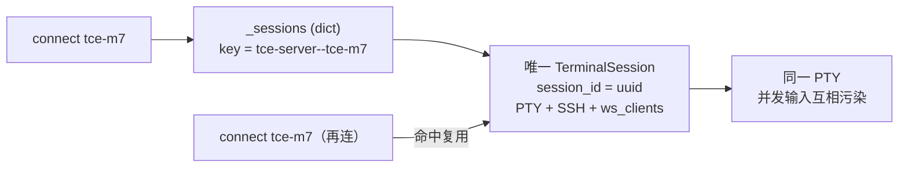
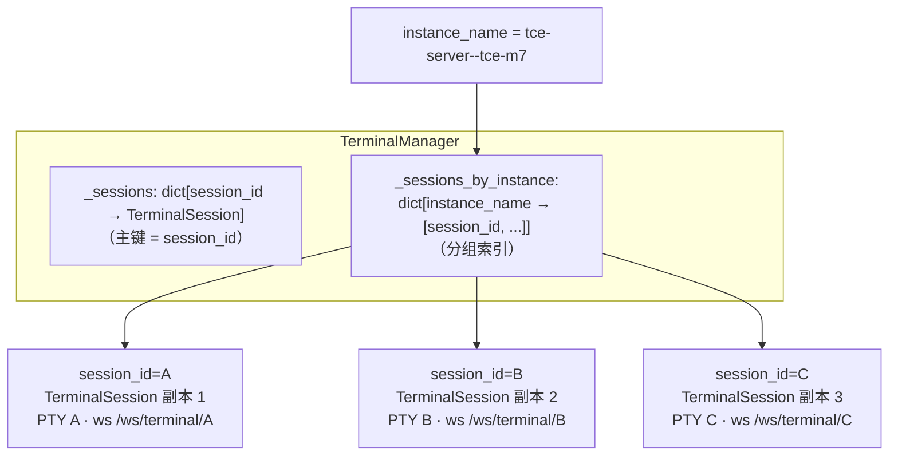
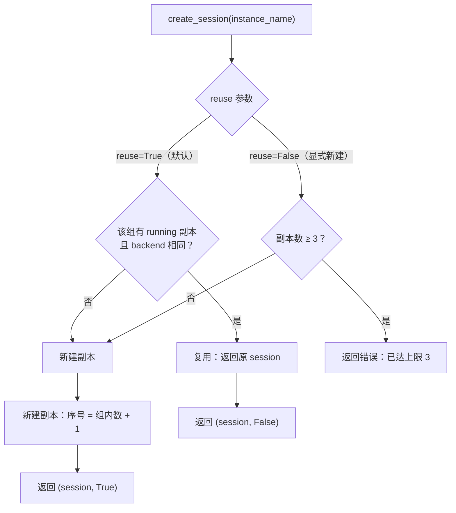

# 会话多副本设计方案

> 状态：待评审
> 日期：2026-11-02
> 目标：同一 host（连接路径）支持多个独立会话副本，解决「并发操作同一会话互相污染」问题，同时不破坏现有「同 host 复用」默认行为。

## 1. 背景与目标

### 1.1 背景

当前一个 host（如 `tce-m7`）全局只有一个活跃会话，重复连接会「复用已有终端」。多路输入（MCP + 浏览器、两个 agent）并发操作同一会话时，PTY 单字节流会互相污染。

### 1.2 目标

- 同一 host 可开多个独立会话副本（默认复用，显式新建）
- 副本之间 PTY 完全隔离，互不干扰
- 副本数量有上限（**3 个**），防止资源失控
- 不破坏现有「同 host 复用」的默认行为

## 2. 现状问题（根因）

会话标识被 `instance_name` 双重占用：

```python
# terminal_manager.py
_sessions: dict[str, TerminalSession]     # key = instance_name（连接路径）
create_session(instance_name, ...):
    storage_key = instance_name           # 既是 host 标识，又是存储 key
    if existing.running and backend 相同:
        return existing, False            # → 复用，导致 1 host : 1 session
```

`instance_name = "--".join(path)`（如 `tce-server--tce-m7`），它标识「一条连接路径」，却被同时用作「会话主键」，因此一条路径只能有一个会话。

## 3. 架构图

### 3.1 改造前（1 host : 1 session）



### 3.2 改造后（1 host : N session，上限 3）



各副本：独立 PTY + 独立 SSH 连接 + 独立 ws_clients，字节流完全隔离。

### 3.3 复用 vs 新建流程



## 4. 核心设计决策（已确认）

| # | 决策 | 结论 |
|---|------|------|
| 1 | 主键分离 | `session_id` 升级为唯一主键，`instance_name` 降级为「逻辑分组」 |
| 2 | 复用语义 | `create_session` 加 `reuse` 参数，默认 `True`（复用，向后兼容） |
| 3 | **停止语义** | `stop_session(instance_name)` 停掉该 host 的**全部副本** |
| 4 | **副本 label** | 用序号区分，如 `tce-m7`、`tce-m7 (2)`、`tce-m7 (3)` |
| 5 | **副本上限** | 每个 host 最多 **3** 个副本，超出拒绝新建 |

## 5. 数据模型（`terminal_manager.py`）

```python
# 改造前
_sessions: dict[str, TerminalSession]                 # key = instance_name

# 改造后
_sessions: dict[str, TerminalSession]                 # key = session_id（主键）
_sessions_by_instance: dict[str, list[str]]           # instance_name -> [session_id...]（分组索引）
```

`TerminalSession` 新增字段：

```python
class TerminalSession:
    session_id: str          # 主键（已有）
    instance_name: str       # 逻辑分组（已有）
    replica_index: int = 1   # ★ 新增：组内序号（1-based，创建时 = 组内 running 副本数 + 1）
    # ... 其余不变
```

## 6. 后端改动

### 6.1 `create_session` 改造

```python
_MAX_REPLICAS_PER_HOST = 3

async def create_session(
    self,
    instance_name: str,
    host: Host,
    decrypted_password: str | None = None,
    backend: ... = None,
    reuse: bool = True,                 # ★ 新增
) -> tuple[TerminalSession, bool]:
    selected_backend = resolve_terminal_backend(backend, ...)

    async with self._lock:
        # 复用分支（原逻辑，按组查找）
        if reuse:
            for sid in self._sessions_by_instance.get(instance_name, []):
                s = self._sessions.get(sid)
                if s and s.running and s.backend == selected_backend:
                    return s, False

        # 新建分支：副本上限校验
        running_count = sum(
            1 for sid in self._sessions_by_instance.get(instance_name, [])
            if (s := self._sessions.get(sid)) and s.running
        )
        if running_count >= _MAX_REPLICAS_PER_HOST:
            raise SessionLimitError(
                f"会话副本数已达上限 {_MAX_REPLICAS_PER_HOST}，请先关闭现有终端"
            )

        session_id = str(uuid.uuid4())
        session = TerminalSession(
            session_id=session_id,
            instance_name=instance_name,
            backend=selected_backend,
            replica_index=running_count + 1,
        )
        self._sessions[session_id] = session
        self._sessions_by_instance.setdefault(instance_name, []).append(session_id)

    await session.start(host, decrypted_password)   # 失败回滚两个索引
    return session, True
```

### 6.2 生命周期方法改造

| 方法 | 现状 | 改造后 |
|------|------|--------|
| `get_session(instance_name)` | 返回单个 | 返回该组**最新副本**（兼容旧调用） |
| `get_sessions(instance_name)` | — | **新增**：返回该组全部副本 |
| `get_session_by_id(session_id)` | 遍历 values | `_sessions.get(session_id)`（O(1)） |
| `has_running_session(instance_name)` | 单个 | 任意副本 running 即 True |
| `stop_session(instance_name)` | 停单个 | **停该组全部副本**（逐个 stop + 清索引） |
| `stop_session_by_id(session_id)` | 已有 | 停单个副本 + 从分组索引移除 |

## 7. REST API 改动（`terminal.py`）

### 7.1 `POST /api/terminal/start` 加参数

```python
class StartTerminalRequest:
    host_id: int
    backend: ... | None
    new_session: bool = False      # ★ true 则新建副本（reuse=False）
```

响应不变（`session_id` 已唯一，`ws_url` 已按 session_id 路由）。

### 7.2 列表/停止

- `GET /api/terminal`：返回**所有副本**（每副本一条，含 `session_id` + `instance_name` + `replica_index`）
- `POST /api/terminal/stop/{instance_name}`：停该 host 全部副本
- 新增 `POST /api/terminal/stop-by-id/{session_id}`：停单个副本

## 8. MCP 改动（`server.py`）

```python
async def connect_host(
    host_name: str,
    backend: str | None = None,
    new_session: bool = False,       # ★ 新增
) -> str:
    session, is_new = await mgr.create_session(..., reuse=not new_session)
    # new_session=True：强制新建副本，返回新 session_id
    # 返回提示补充副本序号：如「这是 tce-m7 的第 2 个终端」
```

- 默认 `new_session=False`：保持「复用已有终端」（向后兼容）
- `new_session=True`：agent 显式开新副本，新 session_id 供后续 `run_command`/`upload_file` 使用

## 9. 前端改动

### 9.1 Tab 数据模型（`TerminalTabs.tsx`）

```ts
export interface TerminalTab {
  id: string;            // 改为 tab-${sessionId}
  sessionId?: string;    // ★ 会话主键
  label: string;         // host.name + 序号，如 "tce-m7" / "tce-m7 (2)"
  host: Host;
  instanceName?: string;
  wsUrl?: string;
  backend?: TerminalBackend;
}
```

### 9.2 交互改造（`App.tsx`）

- 点击 host：已有该 host 的 tab → 激活（现状）；否则新建 tab + `start`
- 新增「新建副本」入口：tab 栏右键 / host 项 hover 菜单「在新终端打开」
- 副本 label：`replica_index > 1 ? `${host.name} (${replica_index})` : host.name`

## 10. 多跳编排并发（重点难点）

m7 这类「tce-server → tce-m7」节点，每个副本都要走一次 `ssh + 自动识别`。**同一堡垒机 root 的多个副本并发跳转会冲突**（堡垒机菜单、tmux window 分配）。

方案：按堡垒机 root 串行化跳转：

```python
_jump_locks: dict[str, asyncio.Semaphore]     # key = root.instance_name

async def _run_path_orchestration(session, path):
    root_key = path[0].name
    lock = _jump_locks.setdefault(root_key, asyncio.Semaphore(1))
    async with lock:                          # 同一堡垒机跳转串行
        await ConnectionOrchestrator(session).execute_path(path, ...)
```

跳转阶段串行，跳转完成后释放；PTY 交互阶段各副本并行、互不干扰。

## 11. 副本上限与序号

- **上限 3**：`_MAX_REPLICAS_PER_HOST = 3`，新建时 `running_count >= 3` 抛 `SessionLimitError`
- **序号 1-based**：创建时 = 组内 running 副本数 + 1，**停止后不回收**（保持 label 稳定）
- **上限 + 序号联动**：因序号不回收，组内可能同时存在「序号 1、2、3」或「序号 1、2」（2 停止后新副本仍是 2？—— 见下）
  - 简化策略：序号按**当前 running 副本数 + 1** 计算（动态），停止副本后新建副本会复用释放的序号
  - 例如：副本 1、2、3 都在 → 新建被拒；关闭副本 2 → 新建副本序号 = 2（复用空位）

## 12. 边界情况

| 边界 | 处理 |
|------|------|
| 同 host 不同 backend 副本 | 允许共存（backend 是 session 属性，路由按 session_id） |
| 单个副本断开 | 只影响该 session_id，同组其他副本不受影响 |
| 副本停止清理索引 | `stop_session_by_id` 同步从 `_sessions_by_instance` 移除，防止泄漏 |
| 副本上限拒绝 | 复用分支不受限（复用不增副本），仅显式新建受限 |
| 全局 backend 切换 | 现有「清空全部重建」逻辑需适配新索引结构 |
| 断线重连 | 前端按 session_id 重建，副本各自恢复 |

## 13. 向后兼容

- `create_session` 默认 `reuse=True` → MCP/REST 现有调用零改动
- `get_session(instance_name)` 返回最新副本 → 旧单副本调用方不报错
- 前端默认行为不变（点击 host 激活已有 tab）
- 唯一语义变化：`stop_session(instance_name)` 从「停单个」变为「停全部」——需全局搜索确认调用方

## 14. 实施里程碑（4 步，每步可独立验证）

| 步骤 | 内容 | 验证 |
|------|------|------|
| 1 | 后端存储解耦 + `reuse` + 上限 3 + 生命周期适配 | MCP 跑通「m7 开 2 会话」 |
| 2 | REST `new_session` + MCP `new_session` 入口 | 同 host 建 2 副本返回不同 session_id |
| 3 | 前端多 tab + 「新终端打开」入口 | 浏览器开 2 个 m7 tab |
| 4 | 多跳串行化信号量 | 并发连 m7 副本跳转不冲突 |

## 15. 风险

- 改动横跨存储/API/MCP/前端四层，需小步提交、每步可回滚
- `stop_session(instance_name)` 语义变化需全局搜一遍调用方
- 多副本资源翻倍（每副本一个 SSH 连接 + PTY），上限 3 已兜底
