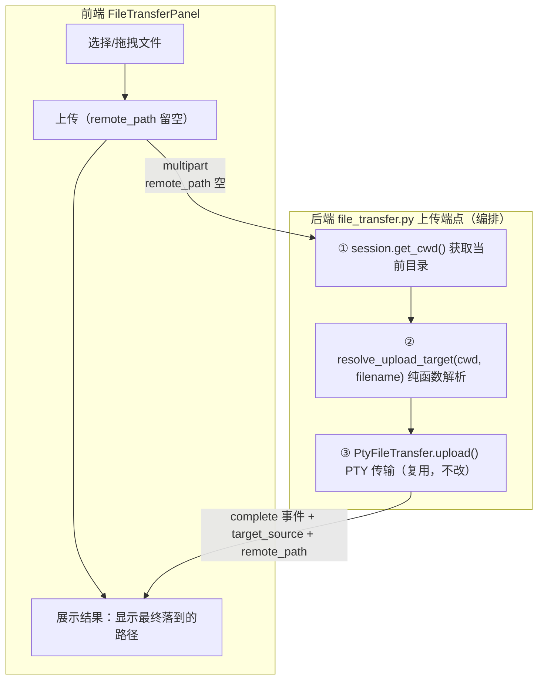

# 上传默认落终端当前目录 设计方案

> 状态：待评审
> 日期：2026-11-02
> 目标：去掉上传面板「目标路径」输入框，上传自动落到终端当前目录（cwd），并满足设计原则、高内聚低耦合、可扩展性、健壮性、可单测。

## 1. 背景与目标

### 1.1 现状问题

上传面板有一个「目标路径」输入框（默认 `/tmp/`），需要用户手动填写远端路径，不友好。

```205:205:frontend/src/components/FileTransferPanel.tsx
const [remotePath, setRemotePath] = useState(() => readStoredPath(STORAGE_KEY_UPLOAD_PATH, "/tmp/"));
```

### 1.2 目标

- **去掉**「目标路径」输入框
- 上传自动落到终端当前目录（cwd）
- 方案满足：设计原则（SOLID）、高内聚低耦合、可扩展性、健壮性、可单测
- cwd 获取失败时回退 `/tmp/`，**且明确提示最终上传到的路径**

## 2. 架构分层（高内聚低耦合）



职责分离：

| 组件 | 职责 | 层 |
|------|------|-----|
| `resolve_upload_target(cwd, filename)` | 算目标路径（纯函数） | 领域逻辑 |
| `TerminalSession.get_cwd()` | 取远端当前目录 | service |
| 上传端点 | 编排：取 cwd → 算路径 → 传输 | 编排层 |
| `PtyFileTransfer.upload()` | PTY 传输 | service（不改） |

## 3. 核心设计

### 3.1 路径解析：纯函数（可单测核心）

```python
# src/api/file_transfer.py 顶部
def resolve_upload_target(cwd: str, filename: str) -> str:
    """解析上传目标路径。纯函数、无 IO、可单测。

    健壮性：
    - filename 取 basename，防御路径穿越（../../etc/passwd）
    - cwd 规范化（去空白、去尾斜杠），空则回退根目录
    """
    safe_name = Path(filename).name or "uploaded_file"
    base = (cwd or "").strip().rstrip("/")
    return f"{base}/{safe_name}" if base else f"/{safe_name}"
```

### 3.2 cwd 获取：service 方法

```python
# terminal_manager.py — TerminalSession
async def get_cwd(self) -> str | None:
    """获取远端当前目录。失败返回 None（由调用方回退）。"""
    out = await self.send_command(
        'printf \'__C\'\'WD__\'"%s"\'__C\'\'WD__\' "$(pwd)"',   # 拆分 marker 防回显自匹配（Bugfix #25）
        wait_pattern=r"__CWD__.*__CWD__", timeout=10.0,
    )
    m = re.search(r"__CWD__(.*?)__CWD__", out)
    return m.group(1).strip() if m else None
```

### 3.3 上传端点：编排 + 目标来源标记

```python
@router.post("/api/terminal/{session_id}/upload")
async def upload_file(session_id, file, remote_path: str = "", ...):
    session = ...
    filename = file.filename or "uploaded_file"

    target_source = "explicit"          # 默认：显式指定
    if not remote_path.strip():
        cwd = await session.get_cwd()
        if cwd:
            target_source = "cwd"
            remote_path = resolve_upload_target(cwd, filename)
        else:
            target_source = "fallback"   # 获取失败，回退 /tmp/
            remote_path = resolve_upload_target("/tmp", filename)

    # ... PTY 传输 ...
    # complete 事件携带：remote_path + target_source
```

**`target_source` 标记**（结构化、可测、可扩展）：

| 值 | 含义 | 前端提示 |
|----|------|---------|
| `cwd` | 正常落到当前目录 | `已上传到 /root/work/xxx.sh` |
| `fallback` | cwd 获取失败，回退 /tmp/ | `未获取到当前目录，已上传到 /tmp/xxx.sh` |
| `explicit` | 显式指定（MCP 场景） | `已上传到 xxx.sh` |

## 4. 设计原则落地对照

| 原则 | 落地 |
|------|------|
| **单一职责** | `resolve_upload_target`（算路径）、`get_cwd`（取目录）、端点（编排）、传输（传输）各司其职 |
| **开闭原则** | 去输入框不改传输逻辑；`remote_path` 参数保留，未来「指定目录」是扩展而非修改 |
| **依赖倒置/低耦合** | 端点依赖抽象（`get_cwd`、纯函数），前端不感知后端如何算路径 |
| **可扩展性** | 路径策略集中在纯函数；`target_source` 标记可扩展（未来「按 host 默认目录」等） |
| **健壮性** | cwd 失败回退、文件名防穿越、cwd 规范化、终端断开 404、**回退时明确提示** |
| **可单测** | 见 §6 |

## 5. 健壮性

| 场景 | 处理 |
|------|------|
| cwd 获取失败（终端忙/断开） | 回退 `/tmp/`，`target_source="fallback"`，前端提示「未获取到当前目录」 |
| 文件名路径穿越（`../../x`） | `resolve_upload_target` 取 basename |
| cwd 为根目录 `/` | 规范化后目标 `/filename` |
| 空文件名 | 默认 `uploaded_file` |
| 终端断开 | 端点 404，前端提示「终端未连接」 |

## 6. 可单测设计（测试点）

| 被测 | 类型 | 用例 |
|------|------|------|
| `resolve_upload_target` | 纯函数单测 | 正常拼接、cwd 空→根目录、cwd 尾斜杠、`../../x`→basename、空 filename→默认名 |
| `get_cwd` | mock 单测（FakeSession） | 返回 `__CWD__/root/work__CWD__`→解析正确；空/超时→None |
| 上传端点 | TestClient + mock session | remote_path 空→`target_source=cwd` 且路径正确；cwd 失败→`fallback`+`/tmp/`；remote_path 显式→`explicit`+原路径 |

纯函数 + mock session 让核心逻辑**无需真实 SSH** 即可覆盖。

## 7. 前端改动

- 删除 `_UploadTab` 的「目标路径」输入框 + `remotePath` 状态 + `STORAGE_KEY_UPLOAD_PATH` 持久化
- 上传时 `remote_path` 不传（空）
- 根据 complete 事件的 `target_source` 显示不同 toast：
  - `cwd` → `已上传到 {remote_path}`
  - `fallback` → `未获取到当前目录，已上传到 {remote_path}`
- 历史记录保留 `remote_path`，展示最终路径

## 8. 向后兼容与扩展性

- **MCP `upload_file(remote_path=...)` 不受影响**：仍可显式指定路径
- **浏览器上传**：去掉输入框，走「cwd 兜底」
- 同一端点统一处理「空 → cwd / fallback」，两条调用路径不分裂
- 未来扩展：前端若需「上传到指定目录」高级选项，后端 `remote_path` 已支持，只需前端加回可选入口

## 9. 改动清单

| 文件 | 改动 |
|------|------|
| `src/api/file_transfer.py` | 加 `resolve_upload_target` 纯函数 + 端点编排（remote_path 空→cwd/fallback + target_source） |
| `src/services/terminal_manager.py` | 加 `TerminalSession.get_cwd()` |
| `frontend/.../FileTransferPanel.tsx` | 去输入框 + 按 target_source 提示最终路径 |
| `frontend/.../api.ts` | 上传响应类型加 `target_source` |
| `tests/` | 新增 `resolve_upload_target` 单测 + `get_cwd` mock 单测 + 端点测试 |

## 10. 决策记录（已确认）

| # | 决策 | 结论 |
|---|------|------|
| 1 | cwd 获取失败回退 | 回退 `/tmp/`，但**明确提示最终路径**（`target_source="fallback"`） |
| 2 | 方案落地形式 | 落成设计文档（本文件），评审后再实施 |
